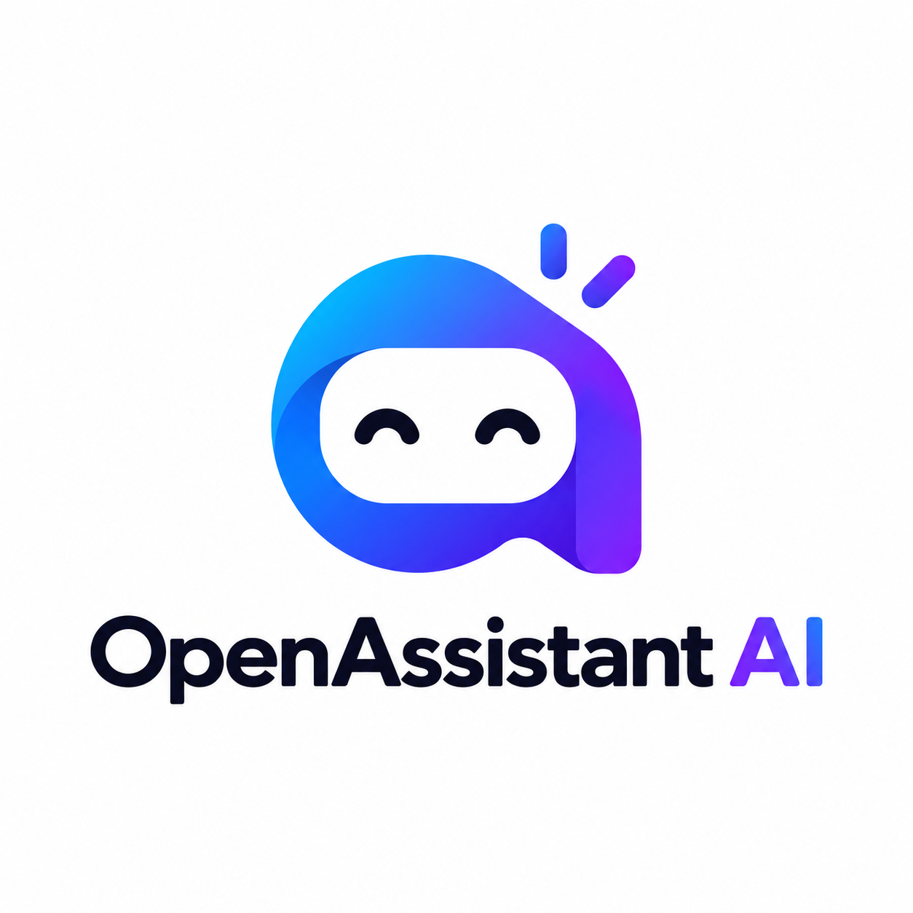

# OpenAssistant AI

<p align="center">
  
</p>

<p align="center">
  <strong>An open-source, Telegram-first personal AI assistant with proactive escalating reminders, multi-provider model routing, and persistent long-term memory.</strong>
</p>

<p align="center">
  <a href="https://github.com/Jnyananjan/OpenAssistant-AI/releases"></a>
  <a href="https://github.com/Jnyananjan/OpenAssistant-AI/actions/workflows/ci.yml"></a>
  <a href="LICENSE"></a>
  <a href="https://github.com/Jnyananjan/OpenAssistant-AI/stargazers"></a>
  <a href="https://github.com/Jnyananjan/OpenAssistant-AI/network/members"></a>
  <a href="https://github.com/Jnyananjan/OpenAssistant-AI/issues"></a>
  <a href="CONTRIBUTING.md"></a>
</p>

<p align="center">
  <a href="#why-openassistant-ai">Why This?</a> •
  <a href="#the-experience">Experience</a> •
  <a href="#features">Features</a> •
  <a href="#prerequisites--urls">Prerequisites</a> •
  <a href="#quickstart">Quickstart</a> •
  <a href="#more-features-coming-soon">Upcoming</a> •
  <a href="#architecture">Architecture</a> •
  <a href="#star-history">Star History</a>
</p>

---

## Overview

Most conversational chatbots answer a prompt and forget about you. **OpenAssistant AI** is built for the part that comes *afterwards*: capturing commitments in plain English, calculating deadlines in your local timezone, and following up proactively until you acknowledge or reschedule.

It pairs an automated Telegram conversational bot with Supabase Edge Functions, PostgreSQL persistence with `pg_cron` scheduling, a modern developer operations cockpit dashboard, and an ultra-fast multi-provider AI hub (Google Gemini, Groq, OpenAI, Anthropic Claude, OpenRouter).

### 📱 The Experience

```
You: "Remind me to submit the quarterly audit report tomorrow at 10 AM"
OpenAssistant: "Got it! ⏰ Scheduled 'Submit quarterly audit report' for tomorrow at 10:00 AM."

--- (Next morning at 10:00 AM) ---
OpenAssistant: "🔔 Reminder: Submit quarterly audit report!"
[ ✅ Done ]   [ ⏱️ Snooze 1h ]   [ 📅 Reschedule ]

--- (If ignored: 10:10 AM follow-up) ---
OpenAssistant: "⚠️ Follow-up 1/8: 'Submit quarterly audit report' is still pending. Don't let it slip!"
[ ✅ Done ]   [ ⏱️ Snooze 1h ]   [ 📅 Reschedule ]
```

---

## Why OpenAssistant AI?

| Feature | OpenAssistant AI | Traditional Reminder Apps (Apple / Todoist) | Standard Voice Assistants (Siri / Alexa) |
|---|---|---|---|
| **Cascading Follow-ups** | ✅ Aggressive escalations (10m, 30m, 60m...) | ❌ Beeps once and disappears into notifications | ❌ Single reminder only |
| **Conversational Rescheduling** | ✅ Chat naturally in Telegram | ❌ Clunky date pickers | ⚠️ Rigid voice commands |
| **Monthly Cost** | 🆓 **$0** (Free-tier Supabase + Groq/Gemini) | 💳 $4 - $10/month recurring subscription | 💳 Locked to proprietary devices |
| **Data Privacy** | 🛡️ 100% self-hosted on your own PostgreSQL | ❌ Stored on third-party SaaS servers | ❌ Logs conversations for corporate training |
| **Response Latency** | ⚡ **<300ms** via Groq LPUs & Gemini Flash | N/A | 🐢 1.5s - 3s cloud roundtrip |

---

## Features

- 💬 **Telegram-First Productivity:** Natural-language conversational interface. Type `"Remind me to call Mom at 6 PM"` or `"Drink water in 30 minutes"` to schedule tasks instantly.
- ⏰ **Proactive Escalating Reminders:** Never miss a task again. If an alert is ignored, OpenAssistant AI follows up automatically (10m, 30m, 60m up to 8 configurable attempts) with inline action buttons (**Done**, **Snooze 1h**, **Reschedule**).
- ⚡ **Ultra-Fast Edge Inference:** Powered by Google Gemini (`gemini-3.5-flash-lite`) and Groq LPU inference for instant, sub-second responses without lag.
- 🎛️ **Modern Operations Cockpit:** Integrated web dashboard on `http://localhost:3000` to inspect live health, trigger instant reminders, pause/resume, snooze, acknowledge, or delete tasks.
- 🧠 **Persistent Long-Term Memory:** Remembers facts, user preferences, project context, and relationship details across conversations.
- 🔀 **Multi-Provider AI Routing:** Connect your own API keys for Google AI Studio, Groq, OpenAI, Claude, or OpenRouter with zero vendor lock-in.
- 🛡️ **Zero-Trust Security:** Local credentials sealed with AES-256-GCM encryption (`scrypt`), Telegram sender allowlist enforcement, and strict secret verification.

---

## Prerequisites & URLs

Before setting up, gather the following developer credentials. **Google AI Studio** and **Groq** are strongly recommended for high speed and generous free tiers:

| Credential | Recommendation | Purpose | Where to Get It |
|---|---|---|---|
| **Google Gemini API Key** | ⭐ **Recommended (Primary)** | Ultra-fast intent parsing & structured outputs | [Google AI Studio](https://aistudio.google.com) |
| **Groq API Key** | ⭐ **Recommended (Fastest)** | Ultra-low latency Llama-3 inference (<300ms) | [Groq Console](https://console.groq.com) |
| **Telegram Bot Token** | Required | Bot messaging & inline action buttons | [@BotFather on Telegram](https://t.me/BotFather) |
| **Telegram User ID** | Required | Restricts your bot to your private ID | [@userinfobot on Telegram](https://t.me/userinfobot) |
| **Supabase Project & Token** | Required | Serverless database, cron, & edge functions | [Supabase Dashboard](https://supabase.com) |
| **OpenAI / Claude / OpenRouter** | Optional | Multi-model routing & fallbacks | [OpenAI](https://platform.openai.com) • [Anthropic](https://console.anthropic.com) • [OpenRouter](https://openrouter.ai) |

> 💡 **Tip:** Pairing **Google AI Studio** (for high context & reliable JSON parsing) with **Groq** (for blazing-fast responses) gives the best conversational speed with zero subscription costs.

---

## Quickstart

### 1. Clone the Repository

```bash
git clone https://github.com/Jnyananjan/OpenAssistant-AI.git
cd OpenAssistant-AI
```

### 2. Install Dependencies

```bash
npm install
cd dashboard && npm install && cd ..
```

### 3. Launch Setup Service & Modern Dashboard

Run the unified setup launcher:

```bash
npm run setup
```

This starts:
- 📡 **Local Setup Service** listening on `http://localhost:4000`
- ⚡ **Modern Operations Dashboard** live on `http://localhost:3000`

### 4. Configure & Deploy

1. Open `http://localhost:3000/setup` in your browser.
2. Enter your **Telegram Bot Token**, **Telegram User ID**, **Supabase Project Reference**, and **API Keys** (Google AI Studio / Groq).
3. Use the **Test Connection** button next to each field to verify live connectivity.
4. Click **Deploy OpenAssistant AI** to run database migrations, set Edge Function secrets, configure `pg_cron`, and register your Telegram webhook automatically.

---

## 🚀 More Features Coming Soon!

We are actively developing the next generation of open-source productivity features:

- 🎙️ **Voice Notes & Audio Reminders:** Send voice memos directly in Telegram to parse commitments, deadlines, and shopping lists on the fly via Whisper & Groq Audio.
- 📅 **Two-Way Google & Apple Calendar Sync:** Automatically push scheduled reminders and events directly to your external calendars.
- 📰 **Proactive Daily Briefing:** Receive an automated morning executive summary of today's deadlines, upcoming tasks, and snoozed reminders at 8:00 AM.
- 🦙 **Local LLM & Ollama Support:** Run completely offline on your own hardware without transmitting personal data to cloud providers.
- 👥 **Shared Family & Team Reminder Circles:** Delegate reminders to friends, family members, or team channels in Telegram.
- 📊 **Natural Language Habit Tracking:** Log daily habits, workouts, and routines directly into your personal SQL memory bank.

---

## Architecture

```
User (Telegram)
      │
      ▼
Telegram Bot API
      │ (Webhook POST with secret token)
      ▼
Supabase Edge Function (telegram-webhook) ─── Google Gemini / Groq API
      │ (Validates intent, calculates local time)
      ▼
Supabase PostgreSQL
  ├── public.tasks (title, due_at, status)
  ├── public.reminders (scheduled_at, status, follow_ups)
  └── public.user_memories (semantic context, preferences)
      │
      ▼
pg_cron (* * * * *) ───► Supabase Edge Function (process-reminders)
      │ (Claims scheduled reminders securely)
      ▼
Telegram Alert (Done / Snooze 1h / Pause)
```

---

## Telegram Commands

| Command | Description |
|---|---|
| `/start` | Welcome message and authorization check |
| `/help` | Detailed command list and usage examples |
| `/tasks` | View all active and upcoming tasks |
| `/today` | View tasks and reminders scheduled for today |
| `/add <task> at <time>` | Manually add a task with a specific deadline |
| `/providers` | View or switch active AI models and providers |
| `/memory` | Inspect saved facts and preferences |

---

## Security & Privacy

OpenAssistant AI is built from the ground up for strict privacy:
- **Local Credential Sealing:** All API keys in the dashboard are sealed locally with AES-256-GCM using `scryptSync` key derivation. They are never sent unencrypted or returned to the browser.
- **Telegram Sender Allowlist:** The webhook drops and ignores any messages sent by Telegram IDs not explicitly included in your `ALLOWED_TELEGRAM_USERS` allowlist.
- **Encrypted Webhook Verification:** Telegram calls are verified with `X-Telegram-Bot-Api-Secret-Token`.
- **Database Row Level Security:** Public tables have strict RLS enabled; edge workers communicate via dedicated service roles with zero public leakage.

---

## Star History

[](https://star-history.com/#Jnyananjan/OpenAssistant-AI&Date)

If you find OpenAssistant AI useful, please consider giving the repository a **Star (⭐)**—it helps more developers discover the project and keeps development moving forward!

---

## Contributing

Contributions, bug reports, and feature suggestions are warmly welcomed!
- Read our [Contributing Guidelines](CONTRIBUTING.md) to get started.
- Check out the [Architecture Documentation](docs/ARCHITECTURE.md) to understand the internals.
- For security issues, please see [SECURITY.md](SECURITY.md).

---

## Repository Metadata

- **Name:** OpenAssistant AI
- **Repository:** [https://github.com/Jnyananjan/OpenAssistant-AI.git](https://github.com/Jnyananjan/OpenAssistant-AI.git)
- **License:** [Apache-2.0](LICENSE)

Built with ❤️ for dependable personal productivity.
